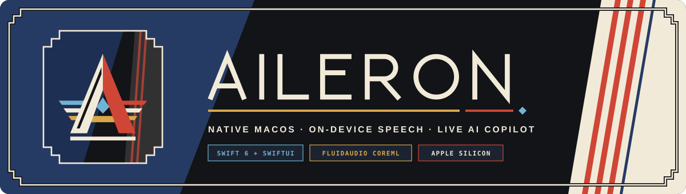
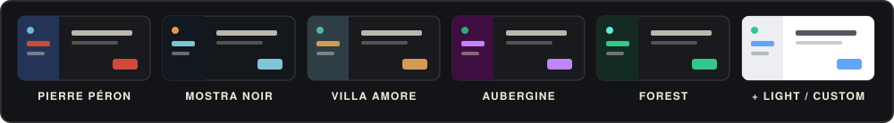
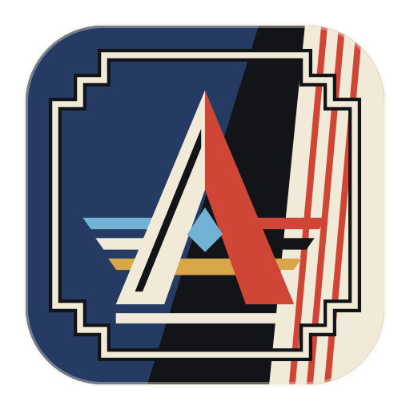

<p align="center">
  
</p>

<p align="center">
  
  
  
  
</p>

<h3 align="center">Built like a precision flight instrument — not a browser tab wrapped in a desktop shell.</h3>

<p align="center">
  <strong>Aileron</strong> is a native macOS AI copilot for technical interviews, architecture reviews, and live conversations.<br/>
  Pure <strong>Swift 6 + SwiftUI + FluidAudio CoreML</strong> on Apple Silicon — zero Electron, zero WebView, zero virtual audio drivers, zero forced cloud accounts.
</p>

<p align="center">
  
</p>

## Why Aileron?

An *aileron* keeps an aircraft level and responsive in real time without getting in the pilot's way. Aileron brings that same quiet discipline to your Mac:

- **Zero Browser Overhead:** One lightweight native macOS process linking `FluidAudio` directly — no Electron, no WKWebView, no Rust↔Swift FFI marshaling, and no base64 audio round-trips.
- **On-Device Ears:** System audio is tapped straight from macOS CoreAudio (no BlackHole or virtual cables), segmented locally with **Silero CoreML VAD**, streamed live via **Parakeet Realtime EOU**, refined with **Parakeet TDT v3**, and speaker-labeled with **Sortformer**.
- **Quietly Invisible:** Native `NSWindow.SharingType.none` hides both the floating bar and main workspace from Zoom, Google Meet, Microsoft Teams, and screen recordings.
- **Yours to Style:** Calm collapsible sidebars paired with a theme studio, vintage French poster palettes, and an unmistakable Art Deco emblem.

<p align="center">
  
</p>

## Key Capabilities

### Real-Time `Listen → Transcribe → AI Answer` Pipeline
- **System Audio (`⌘⇧A`):** CoreAudio Process Tap captures the far end directly, tracks default-output switches automatically (plug in AirPods mid-call without dropping a beat), auto-opens the live transcript drawer, lights up the **`Listen → Transcribe → AI Answer`** status strip, filters out backchannels (`"Yeah."`, `"Mm-hmm."`) and false-positive imperatives, tags detected questions, and queues follow-ups so rapid speech never cuts off an in-flight AI stream.
- **Direct First-Person Coaching:** Captured speech is framed to extract and answer the core question directly in your own voice—suppressing passive filler replies—while manual asks always interrupt immediately when you want to steer the model yourself.
- **Live Streaming Microphone (`⌘⇧M`) & Input Picker:** Words stream into the bar as you speak—click **Send** when finished to polish with Parakeet TDT v3 and ask immediately, or **Cancel** to discard. Pick any specific Mac microphone, headset, or USB audio interface in **Settings → Audio → Microphone Input** with direct CoreAudio device routing.
- **Live Speaker Aliasing:** Click any speaker tag (`Speaker 1`) in the transcript drawer to rename them (`Interviewer`, `Sarah`) across the session and Markdown export.

### Floating Bar ↔ Main Studio Flow
- **Stealth Floating Bar (`⌘\`):** A sleek translucent pill that stays above full-screen apps and never steals focus until you type.
- **Return to App (`pip.exit`):** Dock the floating bar straight back into the main window with a single click — or pop it back out anytime (`pip.enter`) without losing your live session.
- **Collapsible Everything:** Hide the navigation sidebar (`⌘⌥S`), transcript drawer (`⌘⌥T`), session list, or profile list whenever you want a clean, single-column focus view.

### Prep Profiles, Vision Q&A & Searchable Memory
- **Prep Profiles:** Keep tailored profiles (System Design, Behavioral STAR, Executive Call) holding your resume metrics, key projects, and job description notes so answers sound like *you* — never generic AI boilerplate or `[X]` placeholders.
- **Screen Vision Q&A (`⌘⇧S`):** Captures your active display via `ScreenCaptureKit` (automatically excluding Aileron's own windows) and streams visual analysis for code, diagrams, or slides.
- **SQLite WAL + FTS5 Archive:** Every transcript, coaching answer, and generated Executive Brief is full-text searchable in milliseconds and exports cleanly to Markdown.

<p align="center">
  
</p>

## Make It Yours — Slack-Style Themes & Vintage Print Palettes

Open **Settings → Appearance** to tune the workspace live across both windows:

<p align="center">
  
</p>

- **Color Modes:** `System`, `Light`, or `Dark` with automatic WCAG contrast adaptation.
- **Curated Presets:** Vintage graphic print palettes (**Pierre Péron**, **Mostra Noir**, **Villa Amore**) alongside classic studio favorites (**Graphite**, **Aubergine**, **Midnight**, **Forest**, **Espresso**, **Rosewood**, **Monochrome**).
- **Custom Theme Studio:** Pick any **Sidebar**, **Accent**, and **Live Indicator** color with native macOS color pickers, toggle **Window Gradient**, adjust spacing density & text size, or **paste a theme string straight from Slack Preferences**.

<p align="center">
  
</p>

## Quick Start

### Requirements

- **Apple Silicon Mac** (M1 / M2 / M3 / M4) running **macOS 14.2 Sonoma or newer**
- **Xcode 16+** or **Swift 6** Command Line Tools
- Optional: [Ollama](https://ollama.com) or [LM Studio](https://lmstudio.ai) for 100% offline AI (or any OpenAI / Anthropic / Gemini / Groq API key stored in macOS Keychain)

### Build, Bundle & Launch (3 Steps)

```bash
git clone https://github.com/mmiller2890/aileron-v2.git
cd aileron-v2
chmod +x scripts/bundle-app.sh scripts/generate-icon.swift
./scripts/bundle-app.sh release
open build/Aileron.app
```

> **Tip:** Use `./scripts/bundle-app.sh debug` for quick incremental builds during development, or install permanently with `cp -R build/Aileron.app /Applications/Aileron.app`.

### First-Run Setup & Permissions

On first launch, Aileron opens a guided **Setup & Permissions** sheet (re-openable anytime from **Settings**) with live permission status indicators and one-click deep links to macOS System Settings:

| Feature | macOS Permission | Where to Enable |
|---|---|---|
| System Audio (`⌘⇧A`) | **System Audio Recording** | System Settings → Privacy & Security → Screen & System Audio Recording |
| Voice Ask (`⌘⇧M`) | **Microphone** | System Settings → Privacy & Security → Microphone |
| Screen Q&A (`⌘⇧S`) | **Screen Recording** | System Settings → Privacy & Security → Screen & System Audio Recording |

If a permission is missing or revoked mid-session, Aileron surfaces an actionable banner with a direct **Open Settings** button.

*Global shortcuts use native Carbon hotkeys — no Accessibility permission required. If another app already claims a shortcut, **Settings → Keyboard Shortcuts** flags the conflict and lets you re-register without restarting.*

### Privacy-Safe Diagnostics

Need to troubleshoot audio routing, model loading, or shortcut registration? Open **Settings → Permissions & Diagnostics** to copy or export a **Diagnostic Report** containing app version, macOS build, audio devices, hotkey status, and timestamped engine events — **strictly excluding transcripts, prompts, AI replies, and API keys**.

### Connect Your AI Provider

**100% Local with Ollama:**

```bash
brew install ollama
ollama serve
ollama pull llama3.2
```

Open **Models → AI Model**, select **Ollama (Local)**, and click **Refresh** to auto-discover your local models. Prefer cloud models? Switch to **OpenAI**, **Anthropic**, **Google Gemini**, **Groq**, **LM Studio**, or **Custom OpenAI-Compatible** — API keys are stored strictly in **macOS Keychain** (`Security.framework`), never in plain-text config files.

<p align="center">
  
</p>

## Streaming Latency Guide

Configure live caption responsiveness in **Settings → Audio → Streaming Chunk Latency**:

| Chunk Latency | Step Size (16 kHz) | Accuracy (LibriSpeech) | Best For |
|---|---|---|---|
| **160 ms** | 2,560 samples | ~8–9% WER | Fastest word-by-word visual feedback |
| **320 ms (Default)** | 5,120 samples | **~5.7% WER (~14× RTFx)** | **Sweet spot** — crisp speed with ~35% fewer errors than 160 ms |
| **1280 ms** | 20,480 samples | Lowest compute | Ultra-low CPU wakeups for long calls |

*Every finished utterance is still refined by **Parakeet TDT v3** for final accuracy and punctuation.*

<p align="center">
  
</p>

## Keyboard Shortcuts

| Shortcut | Scope | Action |
|---|---|---|
| `⌘\` | Global | Show / Hide Floating Bar |
| `⌘⇧D` | Global | Open / Focus Main Window |
| `⌘⇧A` | Global | Start / Stop System Audio Listening |
| `⌘⇧L` | Global | Answer Last Utterance |
| `⌘⇧S` | Global | Capture Screen & Analyze |
| `⌘⇧M` | Global | Start / Send Streaming Voice Ask |
| `⌘⌥S` | Window | Collapse / Expand Navigation Sidebar |
| `⌘⌥T` | Window | Collapse / Expand Live Transcript Panel |

<p align="center">
  
</p>

## Architecture & Testing

```text
aileron-v2/
├── Sources/
│   ├── AileronCore/
│   │   ├── Audio/      # CoreAudio Process Tap, MicCapture, AudioDeviceManager, RingBuffer, Preprocessor, VAD Segmenter
│   │   ├── Speech/     # Direct FluidAudio SpeechEngine (Parakeet v3, EOU Streaming, Sortformer) & QuestionGate/Heuristics
│   │   ├── AI/         # Typed URLSession.bytes SSE/NDJSON AIClient & direct-answer PromptComposer
│   │   ├── Capture/    # Native ScreenCaptureKit display capture
│   │   ├── Storage/    # macOS KeychainStore, WAL SQLite3 + FTS5 DatabaseStore, SettingsStore
│   │   ├── System/     # Live PermissionsService & privacy-safe DiagnosticsLog
│   │   ├── Models/     # Domain, Settings, and Slack-compatible Theme models
│   │   └── Engine/     # @MainActor @Observable AileronEngine (queued auto-answers & live pipeline state)
│   └── AileronApp/
│       ├── Theme/      # Dynamic ResolvedTheme, Art Deco Emblem & Wordmark, SwiftUI controls
│       ├── Windows/    # Non-activating Stealth NSPanel, Dashboard NSWindow, conflict-aware Carbon HotKeyManager
│       └── Views/      # HUD, Live Studio, Onboarding, Sessions, Prep Profiles, Models, Appearance & Settings
├── Tests/
│   └── AileronCoreTests/
├── assets/             # Graphic-print Art Deco SVG banner, emblem, dividers & theme swatches
└── scripts/            # AppIcon.icns generator & Aileron.app bundler
```

Run the core unit test suite (`12` tests covering audio buffering, speech heuristics, prompt framing, themes, and SQLite FTS5):

```bash
swift test
```

<p align="center">
  
</p>

## Design Ethos & Colophon

<p align="center">
  
</p>

<p align="center">
  Visual identity inspired by interwar French lithographic posters and geometric modernist typography — <em>Pierre Péron</em>, <em>Mostra Nuova</em>, <em>Villa Amore</em>, and <em>Kornog</em>.<br/>
  Design reference archive: <a href="https://fontsinuse.com/tags/2431/art-deco">Fonts In Use — Art Deco</a>
</p>
